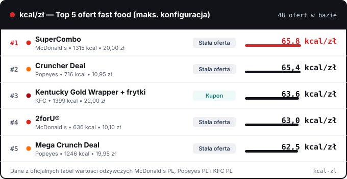

# kcal-zl


Zestawienie ofert, zestawów i kuponów fast food w Polsce sortowanych według przelicznika **kcal/zł**, wraz z **manualnym kreatorem kalorii** i **trybem rozszerzonym (makroskładniki)**, przeznaczone do publikacji na **GitHub Pages**.



## Weryfikacja danych

| Sieć | Kalorie i makroskładniki (`kcal`, białko, tłuszcze, węglowodany, cukry, sól) | Źródła cen |
| --- | --- | --- |
| **KFC Polska** | **Sprawdzone** — oficjalna tabela wartości odżywczych | **Sprawdzone źródło cen** (oficjalna oferta i kupony KFC) |
| **McDonald's Polska** | **Sprawdzone** — oficjalna tabela wartości odżywczych | **Manualne** (wprowadzane ręcznie z regulaminów oraz aplikacji) |
| **Popeyes Polska** | **Sprawdzone** — oficjalna tabela wartości odżywczych | **Manualne** (wprowadzane ręcznie z menu restauracji) |

## Funkcje aplikacji

- **Manualny kreator kalorii (`#kreator`)**: szybkie składanie własnych zestawów ze wszystkich zapisanych oficjalnych pozycji (~538 produktów) lub dodawanie produktów ręcznie. Obsługuje tryb ceny **za całość** oraz **za produkt**, inteligentne wpisywanie wieloelementowe (np. `2x chikker, frytki`) oraz autouzupełnianie klawiaturą (`↑`/`↓`, `Tab`, `Enter`).
- **Ranking ofert i kuponów (`#ranking`)**: konfiguracja wariantów w locie (tryb maks. `kcal/zł` lub domyślny).
- **Tryb rozszerzony**: przełącznik pokazujący pełne makroskładniki z oficjalnych tabel (białko + `g/zł`, tłuszcze i kwasy nasycone, węglowodany i cukry, sól, `kJ`).

## Struktura danych

- [src/data/sources/](./src/data/sources) — zapisane w projekcie oficjalne tabele wartości odżywczych producentów (`mcdonalds-pl.json`, `popeyes-pl.json`, `kfc-pl.json`).
- [src/data/brands.json](./src/data/brands.json) — lista wspieranych sieci restauracji.
- [src/data/items.json](./src/data/items.json) — modułowy katalog kanonicznych produktów (np. ten sam `mcd-cheeseburger` współdzielony między zestawami `SuperCombo`, `SuperCombo Extra` i `2forU®`).
- [src/data/offers.json](./src/data/offers.json) — definicje ofert (`regular` / `coupon`) ze slotami konfigurowalnymi w jednym wierszu tabeli.
- [src/data/creator-catalog.json](./src/data/creator-catalog.json) — pełny katalog pozycji do kreatora kalorii generowany z oficjalnych tabel przez `generate-seo-and-embeds.mjs`.
- [scripts/generate-seo-and-embeds.mjs](./scripts/generate-seo-and-embeds.mjs) — generator danych strukturalnych JSON-LD, kart SVG (`public/embeds/`) oraz katalogu kreatora.
- [scripts/validate-data.mjs](./scripts/validate-data.mjs) — walidacja spójności identyfikatorów, oficjalnych źródeł, kategorii, makr, higieny danych i obrazków.

## Komendy

```bash
npm install
npm run validate
npm run dev
npm run build
```
